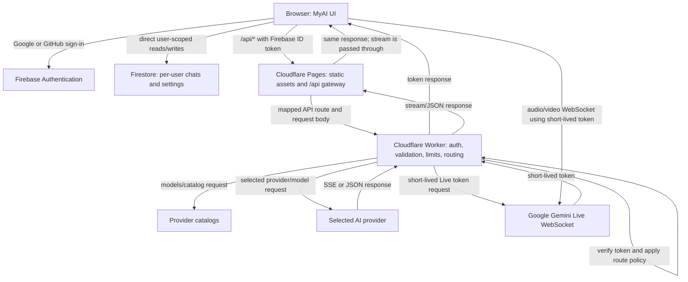

# MyAI request architecture

This document describes the implementation visible in the repository. Hosting, provider accounts, and secrets in a particular deployed environment may differ.

## Browser-to-provider flow

## Request stages

1. **Client and authentication.** The browser signs in through Firebase Authentication. The current UI provides Google and GitHub. Authenticated AI calls include a Firebase ID token; chat history and private settings are separately read from/written to the user's Firestore paths. Local browser storage is also used.
2. **Pages gateway.** `pages/_worker.js` serves static assets and maps selected same-origin paths such as `/api/models`, `/api/gateway`, `/api/chat`, `/api/transcribe`, `/api/live/token`, `/api/images/generate`, and feature routes to the configured Worker hostname. It forwards request bodies and responses rather than implementing model logic. It applies CORS/security headers and a request timeout.
3. **Worker authorization and validation.** The Worker verifies Firebase token signature, audience, issuer, expiry, allowed identity provider, and verified email for protected routes. It checks request shape, route limits, configured provider keys, and selected catalog entries before making upstream calls. Provider keys remain in Worker secrets.
4. **Catalog and model selection.** The Worker returns models from configured Gemini, Groq, OpenRouter, and NVIDIA NIM providers. The browser submits the selected provider and model for gateway chat. App access tiers are not the same as provider price/usage terms.
5. **Upstream request and response.** The Worker calls the selected provider and streams chat responses through Pages to the browser. Non-chat routes can call other services (for example Groq transcription, Gemini image/Live features, Monid/Explorium data services, Canva, or Resend) when the corresponding feature and configuration are used.

## Model access, fallback, and routing disclosures

- The Worker does **not** automatically redirect an arbitrary selected provider to NVIDIA just because an NVIDIA key exists.
- A selected non-free model is rejected by the gateway unless the user's UID is listed in the Worker variable `PREMIUM_ALLOWED_UIDS`. For OpenRouter, the gateway checks its `priceTier`; for other providers it checks `accessTier`.
- Automatic cross-provider fallback candidates are restricted to models the catalog marks `free` (and OpenRouter candidates must also have `priceTier: free`). A fallback can be attempted when the request opts into `allowFallback`, or after an upstream HTTP 402/429 response.
- When fallback succeeds, the SSE response identifies the actual provider/model and explains the substitution. Provider-specific usage, pricing, quotas, and retention still apply to that fallback.
- “Free” is a catalog/access classification, not a guarantee that the provider will never charge, throttle, change eligibility, or exhaust shared quota.

## Files, audio, video, and other feature routes

- File parsing/extraction happens in the browser. When a user submits a prompt with file context or images, relevant extracted content/image data can be included in the request to the Worker and forwarded to the selected provider.
- Durable chat records omit `modelContent`, uploaded image bytes, and generated image blobs. Attachment metadata can remain in chat history; in-memory content is used for follow-up prompts during the current tab session.
- Audio transcription sends the audio file through the Worker to Groq's transcription API. The returned transcription can be added to the conversation.
- Gemini Live first obtains a short-lived token from the Worker; the browser then establishes a WebSocket directly to Gemini Live. Microphone audio and, in video mode, camera frames are transmitted to Google for the Live session.
- Guest routes require Turnstile verification and use an IP address plus a random browser device identifier for guest rate/trial counting. Configure both Turnstile keys; the Worker fails closed if required configuration is absent.

## Configuration boundaries

- **Frontend:** public Firebase web configuration and UI code; never provider secrets.
- **Pages:** static frontend plus same-origin API proxy; configured in `pages/_worker.js`.
- **Worker:** provider secrets and route enforcement; configured in `worker/wrangler.toml` and Cloudflare secret bindings.
- **Firebase:** authentication and user-scoped Firestore records.

The exact deployed secret inventory, provider retention settings, Cloudflare log retention, and Firebase data retention are environment/account settings and cannot be inferred from the code alone.
